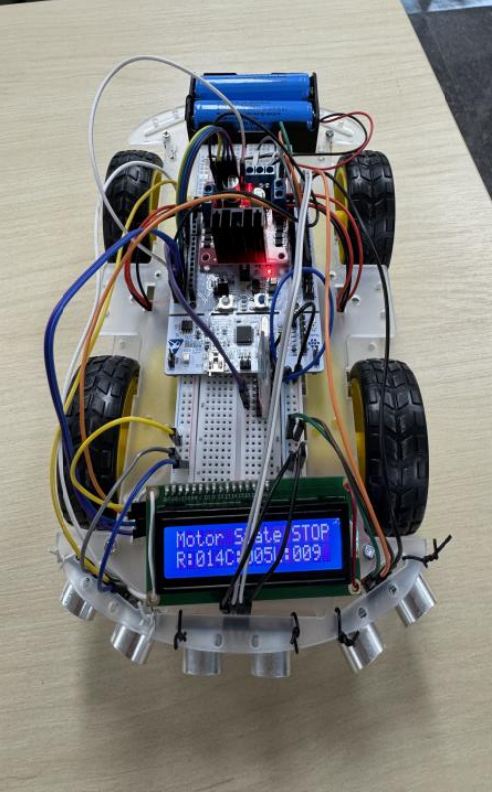
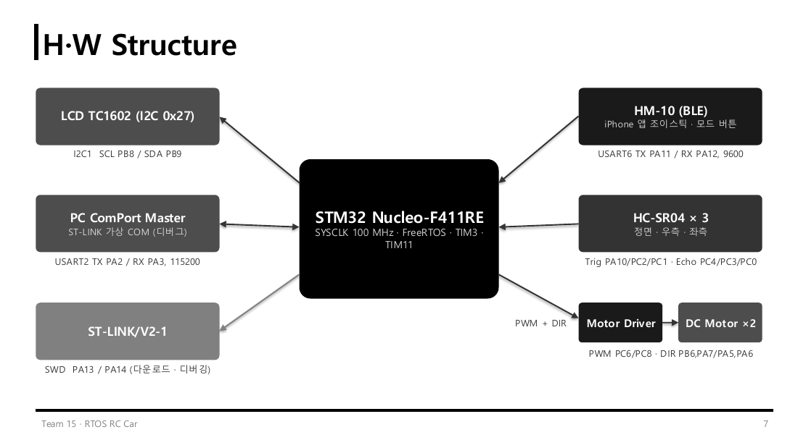
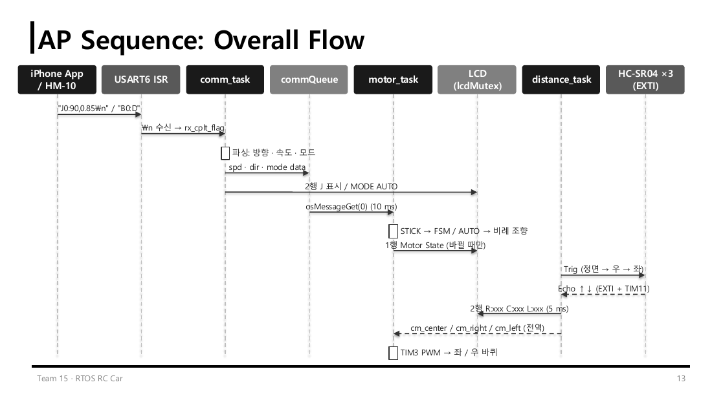
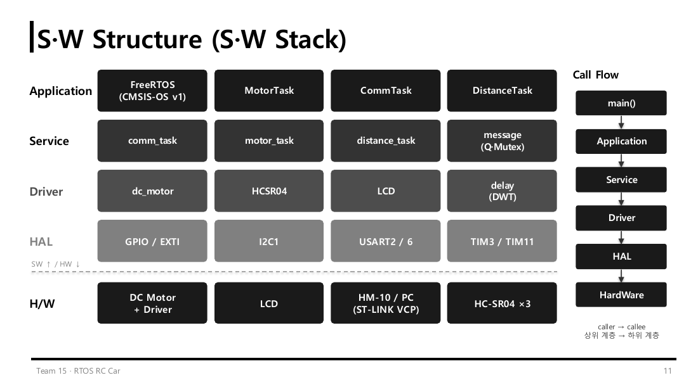
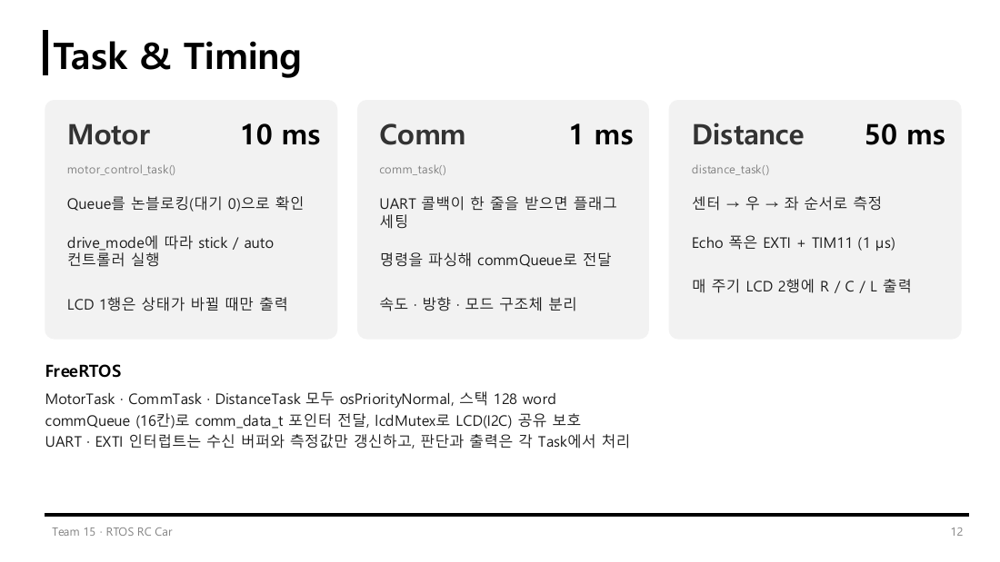
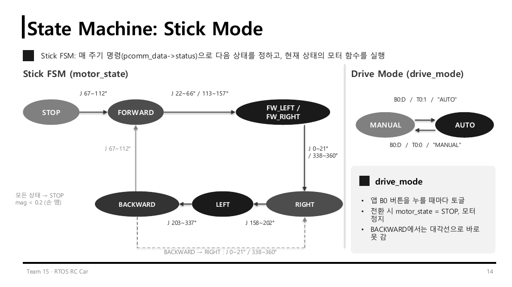
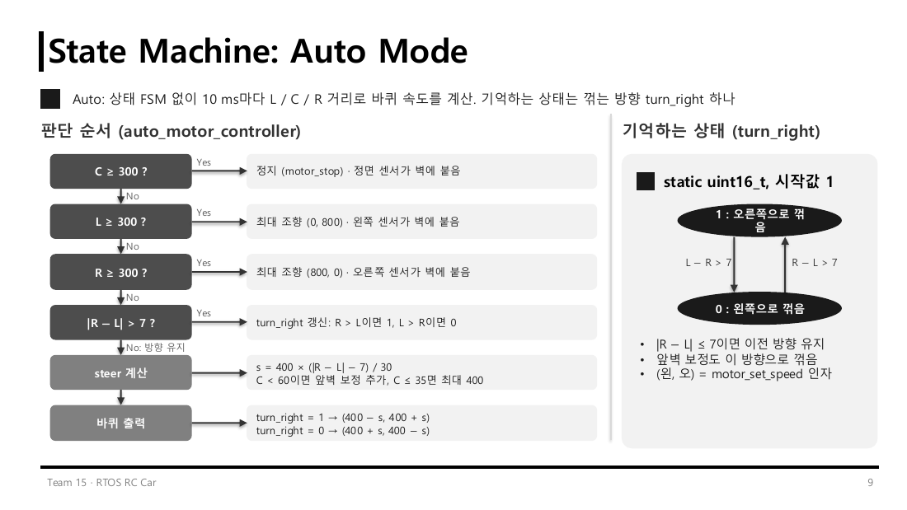
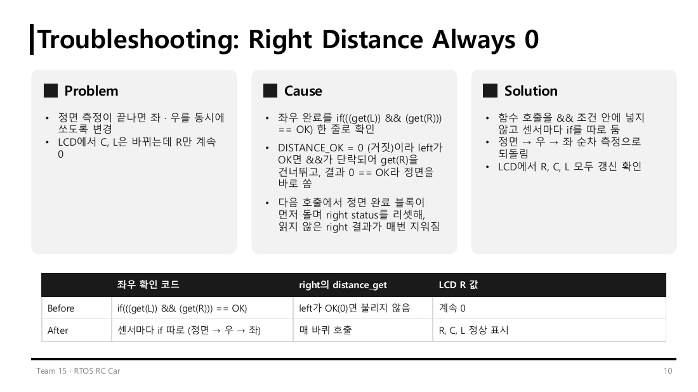
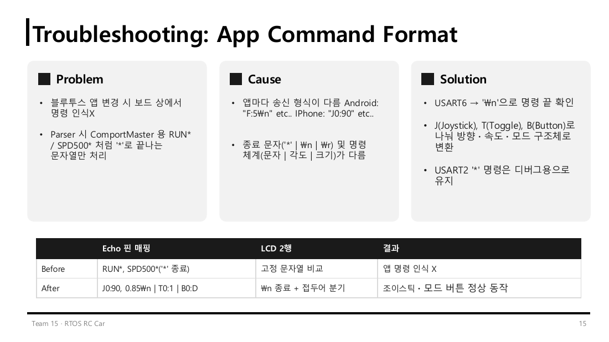

# RTOS RC Car

STM32 Nucleo-F411RE와 **FreeRTOS**로 만든 RC카입니다.
iPhone 앱 조이스틱으로 조종하는 **수동 모드**와, 초음파 센서 3개로 좌우 벽 거리를 재서 스스로 길을 따라가는 **자율 주행 모드**를 앱 버튼 하나로 전환합니다.
통신 · 모터 · 거리 측정을 각각 FreeRTOS Task로 나눠서, 블루투스 명령을 받는 중에도 주행과 측정이 끊기지 않습니다.

> Team 15 · 이기광, 정명훈 (2026.11)
>
> 📑 발표 자료: [docs/RTOS_RC_Car_Project.pdf](docs/RTOS_RC_Car_Project.pdf)

## System Overview

### System Flow

위 그림의 블록을 따라 데이터가 이렇게 흐릅니다.

1. **명령 수신 (iPhone 앱 → HM-10 → USART6)**
   앱 조이스틱과 버튼 명령(`J0:90,0.85`, `B0:D` 등)이 HM-10(BLE)을 거쳐 USART6(9600)으로 들어옵니다. UART 수신 콜백은 `\n`이 오면 플래그만 세웁니다.
2. **명령 해석 (CommTask, 1 ms)**
   `comm_task()`가 한 줄을 파싱해 방향 · 속도 · 모드를 구조체로 나누고, `commQueue`(16칸)로 MotorTask에 넘깁니다. PC(ComPort Master)의 USART2 디버그 명령(`FORWARD*`, `SPD500*`)도 함께 처리합니다.
3. **거리 측정 (DistanceTask, 50 ms → HC-SR04 × 3)**
   정면 → 우 → 좌 순서로 Trig를 쏘고, Echo 펄스 폭을 EXTI + TIM11(1 µs)로 재서 `cm_center` / `cm_right` / `cm_left`를 갱신합니다.
4. **주행 판단 (MotorTask, 10 ms)**
   Queue를 기다리지 않고(대기 0) 확인한 뒤, 모드에 따라 **수동**이면 조이스틱 FSM, **자율**이면 좌우 거리 차이 비례 조향으로 좌 · 우 바퀴 속도를 정합니다.
5. **모터 구동 (TIM3 PWM → Motor Driver → DC Motor)**
   좌 · 우 채널마다 PWM 1선(TIM3 CH1 / CH3)과 방향 2선으로 듀얼 H-브리지를 구동합니다.
6. **표시 (LCD, lcdMutex)**
   LCD 1행에 모터 상태(바뀔 때만), 2행에 `R:xxx C:xxx L:xxx` 거리를 표시합니다. 여러 Task가 LCD(I2C)를 함께 쓰므로 `lcdMutex`로 보호합니다.

> **설계 원칙**: UART · EXTI 인터럽트는 수신 버퍼와 측정값만 갱신하고, 판단과 출력은 각 Task에서 처리합니다.

## 주요 기능

| 모드 | 동작 |
|---|---|
| **Manual** | 조이스틱 각도 → 7방향(전진 · 대각 · 좌우 · 후진), 기울기 0~1 → 속도 0~999, 손을 떼면(20% 미만) 정지, 후진 중에는 대각선 전환 불가 |
| **Mode Switch** | 앱 B0 버튼을 누를 때마다 AUTO ↔ MANUAL, T0 토글과 `AUTO` / `MANUAL` 문자열도 지원, 전환할 때 모터를 먼저 정지하고 새 모드 시작 |
| **Auto** | 초음파 3개 순차 측정(정면 → 우 → 좌), 좌우 거리 차이에 비례해 조향(7 cm 이하 차이는 무시), 정면 60 cm부터 조향 추가 · 35 cm 이하 최대, 바퀴 속도 = 기본 400 ± steer, 센서에 붙으면(300 cm 이상) 정지 |

| 인터페이스 | 내용 |
|---|---|
| Bluetooth | HM-10 (BLE) · USART6 9600 · iPhone 앱 Bluetooth Serial Connect, 한 줄(`\n`) 단위 명령 |
| LCD | 1행 모터 상태 (`Motor State FW` 등) · 2행 거리 `R:xxx C:xxx L:xxx` |
| Debug | USART2 115200 · ComPort Master에서 `FORWARD*`, `SPD500*`처럼 `*`로 끝나는 명령 |

## 소프트웨어 구조

| 계층 | 모듈 |
|---|---|
| Application | FreeRTOS (CMSIS-OS v1): MotorTask, CommTask, DistanceTask |
| Service | `comm_task`, `motor_task`, `distance_task`, message (Queue · Mutex) |
| Driver | `dc_motor`, `HCSR04`, `LCD`, delay (DWT) |
| HAL | GPIO / EXTI, I2C1, USART2 / 6, TIM3 / TIM11 |

### Task & Timing

| Task | 주기 | 동작 |
|---|---|---|
| MotorTask | 10 ms | Queue를 논블로킹으로 확인, `drive_mode`에 따라 stick / auto 컨트롤러 실행, LCD 1행은 상태가 바뀔 때만 출력 |
| CommTask | 1 ms | UART 콜백이 한 줄을 받으면 파싱해서 `commQueue`로 전달, 속도 · 방향 · 모드 구조체 분리 |
| DistanceTask | 50 ms | 정면 → 우 → 좌 순서로 측정, Echo 폭은 EXTI + TIM11(1 µs), 매 주기 LCD 2행에 R / C / L 출력 |

- 세 Task 모두 `osPriorityNormal`, 스택 128 word
- `commQueue`(16칸)로 `comm_data_t` 포인터 전달, `lcdMutex`로 LCD(I2C) 공유 보호

## 상태 머신

### Manual: Stick FSM

- 매 주기 명령(`pcomm_data->status`)으로 다음 상태를 정하고, 현재 상태의 모터 함수를 실행합니다.
- 조이스틱 각도로 방향 결정: 67~112° 전진, 22~66° / 113~157° 대각 전진, 0~21° / 338~360° 우회전, 158~202° 좌회전, 203~337° 후진
- 기울기 0.2 미만(손 뗌)이면 모든 상태에서 STOP
- **Drive Mode**: `MANUAL ↔ AUTO`, 전환할 때 `motor_state = STOP`으로 모터 정지

### Auto: 비례 조향

상태 FSM 없이 10 ms마다 L / C / R 거리로 바퀴 속도를 계산합니다. 기억하는 상태는 꺾는 방향 `turn_right` 하나입니다.

1. 정면 C ≥ 300 → 정지 (정면 센서가 벽에 붙음)
2. L ≥ 300 / R ≥ 300 → 반대쪽으로 최대 조향
3. |R − L| > 7이면 `turn_right` 갱신 (R > L이면 오른쪽), 아니면 이전 방향 유지
4. `steer = 400 × (|R − L| − 7) / 30`, 정면 60 cm 미만이면 앞벽 보정 추가, 35 cm 이하면 최대 400
5. 바퀴 출력: 오른쪽이면 `(400 − s, 400 + s)`, 왼쪽이면 `(400 + s, 400 − s)`

## 트러블슈팅

### ① 오른쪽 거리가 항상 0

| | 좌우 확인 코드 | right의 `distance_get` | LCD R 값 |
|---|---|---|---|
| Before | `if(((get(L)) && (get(R))) == OK)` | left가 OK(0)면 호출되지 않음 | 계속 0 |
| **After** | 센서마다 `if` 따로 (정면 → 우 → 좌) | 매 바퀴 호출 | R, C, L 정상 표시 |

- **현상**: 정면 측정 후 좌 · 우를 동시에 쏘도록 바꿨더니, LCD에서 C와 L은 바뀌는데 R만 계속 0
- **원인**: `DISTANCE_OK = 0`(거짓)이라, left가 OK이면 `&&`가 단락 평가되어 `get(R)`을 건너뜀. 결과가 `0 == OK`라 정면을 바로 다시 쏘고, 다음 호출에서 정면 완료 블록이 먼저 돌며 읽지 않은 right 결과를 매번 지움
- **해결**: 함수 호출을 `&&` 조건 안에 넣지 않고 센서마다 `if`를 따로 둠. 정면 → 우 → 좌 순차 측정으로 되돌려 R, C, L이 모두 갱신되는 것 확인

### ② 앱을 바꾸니 명령을 인식하지 못함

| | 명령 형식 | 처리 방식 | 결과 |
|---|---|---|---|
| Before | `RUN*`, `SPD500*` (`*` 종료) | 고정 문자열 비교 | 앱 명령 인식 안 됨 |
| **After** | `J0:90,0.85\n` · `T0:1` · `B0:D` | `\n` 종료 + 접두어 분기 | 조이스틱 · 모드 버튼 정상 동작 |

- **현상**: 블루투스 앱을 바꾸자 보드가 명령을 인식하지 못함. 파서가 ComPort Master용 `RUN*`, `SPD500*`처럼 `*`로 끝나는 문자열만 처리
- **원인**: 앱마다 송신 형식이 다름(Android `F:5\n`, iPhone `J0:90`). 종료 문자(`*` / `\n` / `\r`)와 명령 체계(문자 / 각도 / 크기)가 다름
- **해결**: USART6은 `\n`으로 명령 끝을 확인하고, J(Joystick) · T(Toggle) · B(Button) 접두어로 나눠 방향 · 속도 · 모드 구조체로 변환. USART2의 `*` 명령은 디버그용으로 유지

## 하드웨어

### BOM

| 부품 | 모델 / 사양 | 수량 | 용도 / 인터페이스 |
|---|---|---|---|
| MCU 보드 | STM32 Nucleo-F411RE (Cortex-M4, 100 MHz) | 1 | 메인 제어, FreeRTOS, ST-LINK 디버깅 |
| DC Motor | DC 기어드 모터 | 4 | 좌 · 우 바퀴 구동 (TIM3 PWM) |
| 모터 드라이버 | 듀얼 H-브리지 드라이버 | 1 | 채널마다 PWM 1선 + 방향 2선 |
| 초음파 센서 | HC-SR04 (5V) | 3 | 정면 · 우 · 좌 거리, Echo는 EXTI |
| LCD | TC1602A-01T 16x2 (I2C) | 1 | I2C1 (0x27), 모터 상태와 거리 |
| Bluetooth | HM-10 (BLE 4.0) | 1 | USART6 9600, 앱 명령 수신 |
| 스마트폰 앱 | iPhone · Bluetooth Serial Connect | 1 | 조이스틱, 모드 버튼 |
| PC | ComPort Master | 1 | USART2 115200, 디버그 명령 |

### Pin Map

| 기능 | 신호 | 핀 | 설정 |
|---|---|---|---|
| I2C1 (LCD) | SCL / SDA | PB8 / PB9 | I2C |
| USART2 (PC) | TX / RX | PA2 / PA3 | 115200 8N1 |
| USART6 (BT) | TX / RX | PA11 / PA12 | 9600 8N1, IT |
| Motor 왼쪽 | PWM / DIR | PC6 / PB6, PA7 | TIM3 CH1 |
| Motor 오른쪽 | PWM / DIR | PC8 / PA5, PA6 | TIM3 CH3 |
| 초음파 정면 | Trig / Echo | PA10 / PC4 | EXTI4 |
| 초음파 우측 | Trig / Echo | PC2 / PC3 | EXTI3 |
| 초음파 좌측 | Trig / Echo | PC1 / PC0 | EXTI0 |

## 결론 및 고찰

**결론**
- Comm · Motor · Distance를 FreeRTOS Task로 나누고 Queue와 Mutex로 연결해, 블루투스 수신 중에도 주행과 측정이 끊기지 않음
- iPhone 앱 조이스틱의 각도와 크기를 7방향과 속도로 바꿔 수동 주행 구현
- 앱 버튼 하나로 AUTO ↔ MANUAL 전환, 전환할 때 모터를 정지해 안전하게 모드 변경

**고찰**
- 고정 거리 기준 자율 주행을 좌우 거리 차이 비례 조향으로 바꿔, 트랙 폭이 달라도 같은 규칙으로 주행
- 같은 센서는 150 ms 이상 간격으로 쏴서 데이터시트 권장(60 ms 이상)을 만족하지만, 다른 센서는 앞 센서가 끝난 직후 바로 쏠 수 있어 간격이 보장되지 않음 → 앞 센서 측정 후 일정 시간 기다린 뒤 다음 센서를 쏘는 처리 필요
- LCD(I2C) 출력이 매 주기 Mutex를 잡아 다른 Task의 LCD 출력이 늦어질 수 있음 → 출력 주기 조절 필요

**Takeaway (정명훈)**
- RTOS의 Task 기반 구조로 타이밍 제약에 대한 설계 부담이 줄어, 기능 개발에 더 집중할 수 있었음
- 여러 Task가 LCD를 함께 쓰면 Mutex 대기가 전체 속도에 영향을 준다는 것을 직접 확인
- 기능을 나눠 개발할 때 함수 형태와 공유 변수 규칙을 먼저 맞춰야 병합이 수월함

## 개발 환경

STM32CubeIDE, STM32 HAL (STM32F4xx), FreeRTOS (CMSIS-OS v1), C
